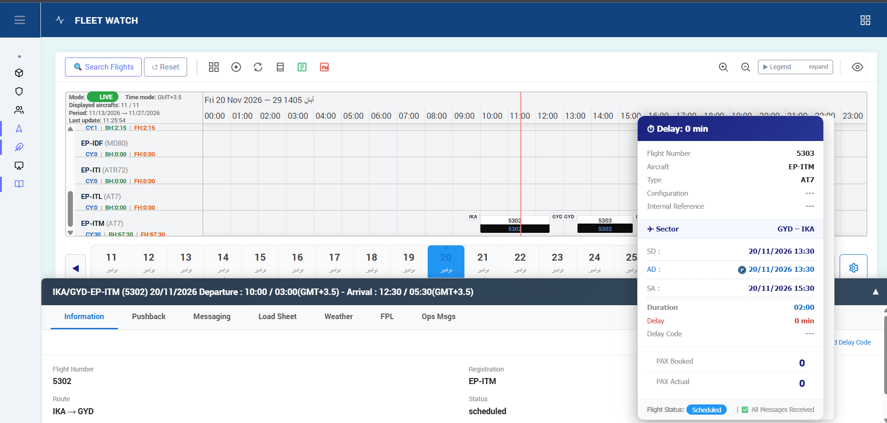
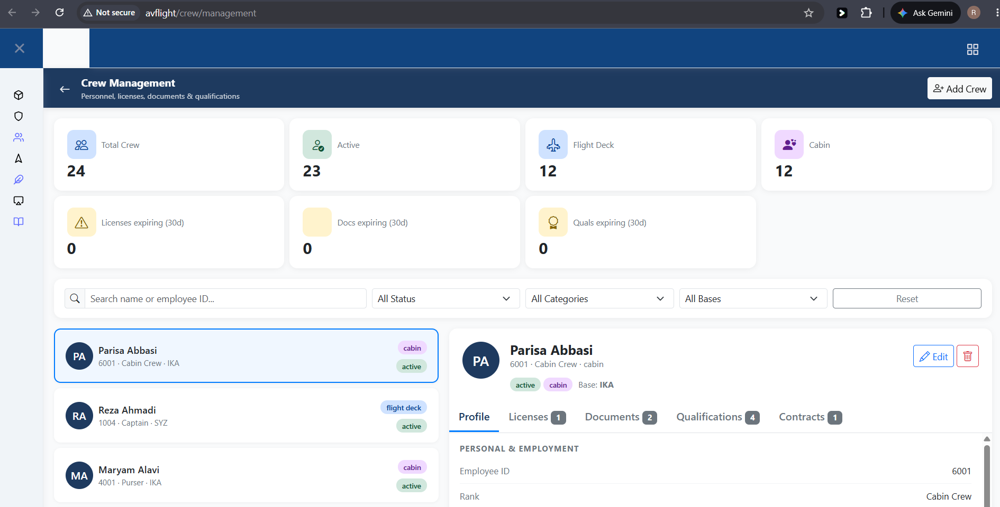
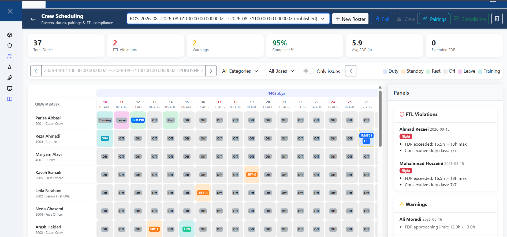
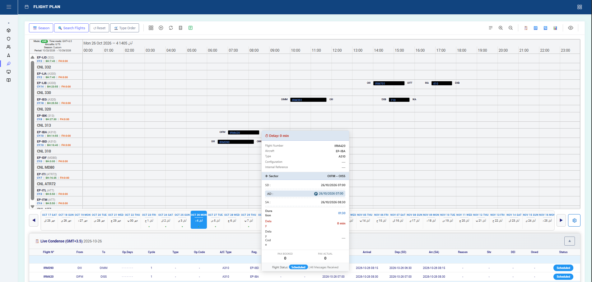

# Flight Management System

An enterprise web application for managing airline operations, flight schedules, and crew resources.

## Overview

This project is designed to bring essential airline operational processes into one integrated management platform.

It covers flight planning, operational monitoring, crew management, scheduling, and aviation document management.

## Screenshots

### Dashboard

### Flight Management

### Crew Management

### Crew Scheduling

### Flight Scheduling

## Main Modules

- Flight Scheduling
- Flight Monitoring
- Crew Management
- Crew Scheduling
- Slot Management
- Delay Code Management
- Delay Reporting
- SSIM Support
- Electronic Flight Bag (EFB)
- Electronic Flight Folder (EFF)
- Aviation Document Management

## Technology Stack

- PHP
- Laravel
- MySQL
- JavaScript
- React
- REST API
- HTML / CSS

## Development Areas

- Enterprise application development
- Database design
- Backend architecture
- API integration
- Business workflow implementation
- Responsive user interfaces

## Project Information

This repository presents the project's capabilities and selected interface screenshots.

Proprietary source code and real operational data are not included.
